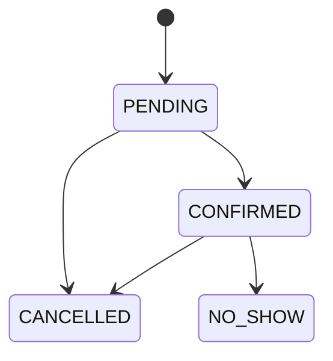

# Reservas API

[](https://github.com/manuelcarro97/reservas-api/actions/workflows/ci.yml)

API REST de reservas de mesa para restaurantes. Comprueba la disponibilidad por turno, asigna mesa y garantiza que una mesa no se reserva dos veces, también cuando dos personas piden la última a la vez.

## Stack

Java 21, Spring Boot 4.1, Spring Data JPA, Spring Security, PostgreSQL 17, Flyway, JUnit 5, Testcontainers, springdoc-openapi, Docker Compose y GitHub Actions.

## Arranque

Requiere Docker.

```bash
cp .env.example .env
docker compose up --build
```

La API queda en `http://localhost:8080`, con Swagger en `http://localhost:8080/swagger-ui/index.html`. El perfil `demo` carga un restaurante ficticio con slug `demo`.

## Ejemplos

```bash
# Consultar turnos
curl "http://localhost:8080/api/v1/restaurants/demo/availability?date=2030-06-12&partySize=2"

# Reservar
curl -X POST http://localhost:8080/api/v1/restaurants/demo/reservations \
  -H "Content-Type: application/json" \
  -d '{"date":"2030-06-12","shiftId":2,"partySize":2,"customerName":"Ana","customerPhone":"600000000"}'

# Consultar o cancelar con el código recibido
curl http://localhost:8080/api/v1/reservations/CODIGO
curl -X POST http://localhost:8080/api/v1/reservations/CODIGO/cancel

# Gestión: lista del día, con las credenciales de .env
curl -u admin:change-me "http://localhost:8080/api/v1/admin/restaurants/demo/reservations?date=2030-06-12"
```

## Reglas de negocio

- El cliente indica personas y turno. El sistema asigna la mesa libre más pequeña que le sirve.
- No se aceptan turnos ya empezados, días de cierre, turnos que no abren ese día ni grupos mayores que la mesa más grande.
- Las fechas y horas se evalúan en la zona horaria de cada local.
- El cliente puede cancelar hasta el plazo del local. El administrador puede cancelar después.



## Cómo evita el overbooking

La garantía está en PostgreSQL, en un índice único parcial:

```sql
CREATE UNIQUE INDEX uq_reservation_active_slot
    ON reservation (table_id, reservation_date, shift_id)
    WHERE status IN ('PENDING', 'CONFIRMED');
```

Cada reserva se inserta con `ON CONFLICT DO NOTHING`. Si otra petición ganó esa mesa, se prueba la siguiente; si no queda ninguna, la API responde 409. Cancelar libera la mesa porque la reserva deja de cumplir el filtro del índice. El motivo está en [ADR 0002](adr/0002-overbooking-indice-parcial.md).

`OverbookingConcurrencyIT` lanza 20 peticiones simultáneas contra PostgreSQL real y comprueba que nunca se reservan más mesas de las que hay.

## Arquitectura

Hexagonal: `domain` no depende de Spring ni de JPA, `application` define los casos de uso y sus puertos, y `adapter` implementa HTTP y persistencia. Ver [ADR 0001](adr/0001-hexagonal.md).

Las mesas guardan su posición (`posX`, `posY`), y el endpoint de ocupación la devuelve para que un cliente pueda dibujar un plano.

## Tests

```bash
./mvnw verify
```

Los tests `*Test` son unitarios y los `*IT` usan PostgreSQL real con Testcontainers, por lo que requieren Docker.

## Límites de la v1

Sin juntar mesas, turnos que cruzan medianoche, emails, pagos ni rate limiting. Hay un único administrador global.

La gestión usa HTTP Basic sin protección CSRF, pensada para `curl` o Swagger. Un panel en navegador necesitaría sesión o tokens con esa protección.

## Licencia

[MIT](LICENSE)
